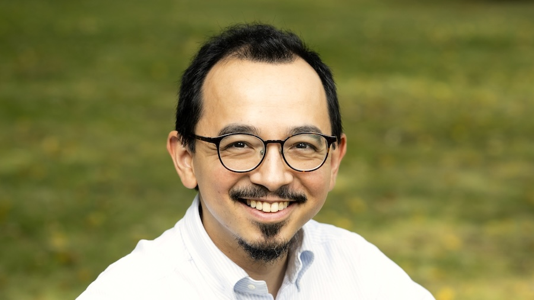

Michael Yoshitaka Erlewine
mitcho

	France

Researcher
CNRS.

## Hello!

I am a Researcher in **linguistics** at the French National Center for Scientific Research (**CNRS**) and Nantes University's [Laboratoire de Linguistique de Nantes](https://lling.univ-nantes.fr/). I received my Ph.D. from [MIT](http://linguistics.mit.edu/) in 2014. My work investigates the structure of sentences (**syntax**) and how these structures map to meaning (**semantics**), with particular interest in **understudied languages of (Southeast) Asia**. I am an Associate Editor of the [*Journal of Semantics*](https://academic.oup.com/jos/) and [*Natural Language and Linguistic Theory*](https://link.springer.com/journal/11049/editorial-board) and Editor of the [*SEALEGS* book series (*Southeast Asian Languages: Empirical Grammatical Studies*)](https://langsci-press.org/catalog/series/sealegs) with Language Science Press.

<!-- , and on the Editorial Board of the [*Journal of East Asian Linguistics*](https://www.springer.com/journal/10831). -->

## Areas of interest

*	Syntax, semantics, and their interface; grammatical variation, learning, and change; languages of (Southeast) Asia
*   Movement: (anti-)locality, (anti-)pied-piping, extraction restrictions, interactions with case and agreement, the interpretation of movement chains
*   Focus and alternatives: focus particles, questions, *wh*-quantification, disjunction, discourse organization (QUDs), implicature calculation

My work has investigated:
* ;
	;
	; 
	; 
	 (Colloquial Singapore English);
* Austronesian: 
	, 
	 (Sumatra), 
	, 
	,
	, 
	 (Philippines), 
	, 
	, 
	 (Borneo), and 
	 (Taiwan);
* Tibeto-Burman: 
	 and 
	;
* Mayan: 
	 and 
	 (Guatemala)

See the [Projects](/projects) page for descriptions of projects and downloadable papers.

## Future plans

* December 2026: Fudan University, December 18
* March 2027: Invited talk at the [DGfS 49 workshop on information structure](https://infostr-dgfs.sciencesconf.org/?lang=en), Jena, 3--5 March 2027
* June 2027: Invited talk at [TEAL 16](https://www.universiteitleiden.nl/en/events/2027/06/theoretical-east-asian-linguistics--16th), Leiden, 10--12 June 2027
* September 2027: Invited talk at [Current issues in comparative syntax: Competing grammars and emergent syntax](https://sites.google.com/view/yosuke-sato-linguistics/current-issues-in-comparative-syntax-3competing-grammars-emergent-syntax), Tokyo

<!-- 15-16 March 2027, Venice ISVL? -->

## Teaching (2026)

* June 1--2: focus workshop at the University of Geneva
* August: [DGfS summer school, Bielefeld](/teaching/dgfs2026/)

<!-- 

# 2027:
* DGfS 49 workshop, Jena, 3--5 March 2027
* TEAL 16, Leiden, 10--12 June 2027
* ESSLLI, Tartu, (one week in) 2--13 August 2027
* Yosuke workshop September 2027
https://sites.google.com/view/yosuke-sato-linguistics/current-issues-in-comparative-syntax-3competing-grammars-emergent-syntax

 -->

<!-- {::options parse_block_html="true" /} -->

## Recent

*	**Paper published, October 2026:** ["Locality and (minimal) search"](/research/locality-search.html) with Kenyon Branan has appeared in the [*Cambridge Handbook of the Minimalist Program*](https://doi.org/10.1017/9781108864152)
*	**NEW:** I am starting a new book series, [**SEALEGS**: *Southeast Asian Languages: Empirical Grammatical Studies*](https://langsci-press.org/catalog/series/sealegs), with Language Science Press!
*	**Paper accepted, July 2026:** ["Japanese contrast sluicing and pair-list questions"](/research/contrast-sluicing.html) with [Teruyuki Mizuno](https://teruyuki-mizuno.github.io/), in *Linguistic Inquiry*!
*	**Talks, June+ 2026:**
	* ["Word order and interpretation order in Japanese scrambling"](/research/talk-wafl2026.html), invited talk at [WAFL 19](https://sites.google.com/view/wafl19/)
	* ["Learning the A- vs Ā- movement distinction"](/research/talk-ralfe2026.html) at [RALFe 9](https://sites.google.com/view/ralfe2026)
	* ["Emergence of passive voice in Central Borneo"](/research/talk-jlao2026.html) with Alex Smith, [JLAO 39](https://jlao-39.sciencesconf.org/)
*	**Talk, April 2026:** ["Atayalic subjects and the nature of nominative"](/research/talk-glow2026.html), at GLOW 48
*	**Talk, March 2026:** "Learning to move," at the [Formal Linguistics in the Nordic Countries (FLiNC) colloquium](https://sites.google.com/view/flinc-formal-linguists-nordic/online-colloquium)
*	**I have moved!** I am now a CNRS Researcher (*chargé de recherche*) at CNRS & Nantes University's [Laboratoire de Linguistique de Nantes](https://lling.univ-nantes.fr). (My previous nus.edu.sg email does not work.)

<!-- *	**Paper revised, January 2026:** ["Atayalic subjects and the nature of nominative"](/research/atayalic.html); comments welcome! -->

<!-- 
*	**Paper published, January 2026:** ["Bornean passives in comparative perspective"](/research/lebo-vo-passive.html) with Alex Smith, has appeared in [a new Festschrift for Jim Huang](https://benjamins.com/catalog/la.290)
*	**Paper published, December 2025:** ["Voice and extraction in Malayic"](/research/malayic.html) with [Carly Sommerlot](https://sites.google.com/view/cjsommerlot), has appeared in (the last physical issue of) *Language*!
*	**Paper published, November 2025:** ["Interpreting Tagalog clitic cluster combinations"](/research/clitics-triplea.html) with Henrison Hsieh
*	**Paper published, October 2025:** ["On the role of causation in sufficiency and excess"](/research/sufficiency.html), in the volume *Generative Perspectives on Degrees: The Semantics and Morphosyntax of Scalarity*
*	**Paper published, September 2025:** ["Varieties of question bias: Lessons from Vietnamese"](/research/vietnamese-bias.html) with Anne Nguyen has appeared in *Languages*!
 -->

<!-- 
*	**Video, January 2024:** Short video on ["Kaqchikel Agent Focus and multiple extraction"](https://spw.uni-goettingen.de/projects/maya/sct-VER.php) as part of the University of Göttingen's online [Glottothèque: Mayan languages](https://spw.uni-goettingen.de/projects/maya/) initiative
 -->

## Less recent but still pretty good

*	["Voice and extraction in Malayic"](/research/malayic.html) with [Carly Sommerlot](https://sites.google.com/view/cjsommerlot) in *Language*, 2025
*	["Interrogative and standard disjunction in Mandarin Chinese"](/research/haishi.html) in *Journal of Semantics*, 2025
<!-- *	["Focus intervention, multiple association, and the unity of focus and *wh* alternatives"](/research/focus-wh.html) in *Linguistics and Philosophy*, 2025 -->
<!-- *	["Ingredients of excess: A study of Vietnamese *quá*"](/research/vietnamese-qua.html) with Anne Nguyen in *Asian Languages and Linguistics*, 2024 -->
<!-- *	["Ā-probing for the closest DP"](/research/closest-dp.html) with [Kenyon Branan](https://sites.google.com/view/kbranan/home) in *Linguistic Inquiry*, 2024 -->
*	["Anti-pied-piping"](/research/anti-pied-piping.html) with [Kenyon Branan](https://sites.google.com/view/kbranan/home) in *Language*, 2023
<!-- *	["Bikol clefts and topics and the Austronesian extraction restriction"](https://mitcho.com/research/bikol.html) with Cheryl Lim in *Natural Language & Linguistic Theory*, 2023 -->

<!-- 
*	[August 2022 NUS news feature](https://news.nus.edu.sg/discovering-invisible-rules-behind-the-worlds-languages/)
*	"Patterns of relativization in Austronesian and Tibetan" talk at the [ICU Linguistics Colloquium](https://sites.google.com/info.icu.ac.jp/linglab/projects/icu-linc/icu-linc), May 2021, available [**on YouTube**](https://www.youtube.com/watch?v=EQKqkXSKQYw).
 -->

